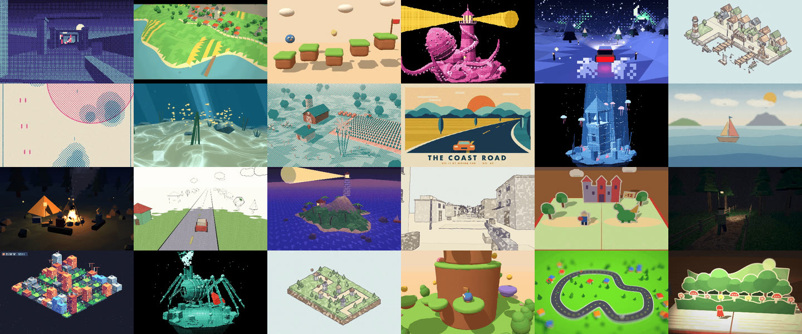

# ゲームのルック試作

[](https://yuki-sakaguchi.github.io/game-looks/)

いろいろなゲームのジャンルに、新しい見た目（ルック）を当ててみた小さな試作集です。印刷、画材、古い画面、手芸、模型などの「見立て」を 1 つずつ選び、ブラウザで動く 1 場面にしています。

**見る・遊ぶ → https://yuki-sakaguchi.github.io/game-looks/**

ほとんどは操作がなく、自動で動く場面を見るだけです。気に入ったルックは、自分で操作して遊べるゲームに育てて `games/` に置いています。

## 中身

| 置き場所 | 内容 | 数 |
|---|---|---|
| [`game-looks/`](game-looks/) | 第 1 集。幅ひろく探したルック。2D（Canvas）と 3D がまざる | 100 案 |
| [`game-looks-2/`](game-looks-2/) | 第 2 集。第 1 集のお気に入り 20 案の傾向（奥行きと光、ローポリ、ドット絵、カメラごしの映像、小さな模型）で作りこんだもの | 21 案 |
| [`game-looks-3/`](game-looks-3/) | 第 3 集。黒い空間に浮かぶドット絵のジオラマ | 10 案 |
| [`game-looks-4/`](game-looks-4/) | 第 4 集。第 1 集 06「色鉛筆のハッチング」の描き方のまま、場面と画角を変えたもの | 16 案 |
| [`game-looks-5/`](game-looks-5/) | 第 5 集。第 1 集と同じように幅ひろく探した、新しい見立て。印刷と紙、壁画、カメラとレンズ、古い画面、光、からくり、工芸、模型など。共通部品はなく、1 案ずつ独立 | 50 案 |
| [`game-looks-6/`](game-looks-6/) | 第 6 集。気に入ってもらった傾向だけで作ったもの。全部ローポリの 3D の場面で、光と天気、立体のドット絵、立体の版画・画材、箱庭、カメラごしの映像 | 50 案 |
| [`game-looks-7/`](game-looks-7/) | 第 7 集。箱ばかりのローポリを 2 つの方向で直したもの。01〜10 は面を増やして形を作りこんだ「こまかいローポリ」、11〜20 はドット絵のテクスチャを描きこみ、ブラウン管のにじみで見せるもの | 20 案 |
| [`game-looks-8/`](game-looks-8/) | 第 8 集。第 7 集の「描きこんだテクスチャとブラウン管」のテイストで題材を広げたもの。ファンタジー、廃墟、海の中、海に浮かぶ廃墟、鉄の都市の下町。部品集は第 7 集の物を読み、題材ごとの追加の部品（`pack-*.js`）を持つ | 50 案 |
| [`game-looks-9/`](game-looks-9/) | 第 9 集。第 8 集と同じテイストで、雰囲気をダークにしたもの。ダークファンタジー、夜の廃墟、深い海、暗い海の廃墟、鉄の都市の下町。部品集は第 7・8 集の物を読み、ダーク用の部品（`pack-dark.js`）を持つ | 50 案 |
| [`game-looks-10/`](game-looks-10/) | 第 10 集。第 7〜9 集のテイスト（描きこんだテクスチャとブラウン管）の場面と人を使った、ゲームの画面の試作。01〜08 はジャンルごとのバトル（ターン制、竜の狩り、ロックオンのアクション、ダンジョン、巨大な像、固定カメラのホラーなど）、09〜16 はそのボス戦、17〜29 はほかのジャンル（対戦格闘、マス目の戦術、空のシューティング、ステルス、町の会話と店、乗りものの追いかけっこ、大軍をなぎたおす、広い世界の探検、町をとびまわる、武器を作って使い分ける、暮らしのある町、輪のメニュー、部品を組みかえるロボット）。窓や数字もドット絵で、ブラウン管を通す | 29 案 |
| [`game-looks-11/`](game-looks-11/) | 第 11 集。第 8 集（明るい）と第 9 集（ダーク）のテイストのまま、新しい土地へ題材を広げたもの。和の里、砂と草原の旅、雪と北の国、密林と古い遺跡、蒸気と歯車の町。まとまりごとに明るい場面とダークな場面をまぜる。部品集は第 7〜9 集の物を読み、まとまりごとの追加の部品（`pack-*.js`）を持つ | 50 案 |
| [`game-looks-12/`](game-looks-12/) | 第 12 集。同じテイストで作った 5 つの世界。絵本の世界、霧と飛空艇の王国、上と下の鉄の都市、ネオンの港町、白い電脳世界。巨大な物や遠くの物を主役の向こうに見せる場面を多くした。部品集は第 7〜9・11 集の物を読み、まとまりごとの追加の部品（`pack-*.js`）を持つ | 50 案 |
| [`game-looks-14/`](game-looks-14/) | 第 14 集。毎朝 1 つ、新しいテーマで 1 場面を足していく集（作り方は `docs/daily.md`、記録は `docs/daily-log.md`） | 4 案 |
| [`games/`](games/) | あそべるゲーム。ルックから育てた、操作して遊べるもの | 7 本 |

- どのフォルダにも `index.html`（一覧）と `thumbs/`（サムネイル）があります。
- トップの `index.html` は、各集とあそべるゲームへの入口です。
- `docs/readme-tiles.jpg` は、この README の上の画像です。
- `docs/taste.md` は持ち主の好みの記録、`docs/prompts.md` は頼み方のひな形です。
- `.claude/skills/` は、好みの 2 つのテイストで絵を作るためのスキル（Claude Code が読む手順書）です。`CLAUDE.md` はその入口です。
- `tools/cap.mjs` は、ページを開いてエラーと絵を確かめ、サムネイルを作る道具です。

## 好みのテイストで作る

これからの絵づくりは、第 7 集の 2 つのテイストで行います。

| テイスト | ひとことで | 見本 | 部品集 | 作り方 |
|---|---|---|---|---|
| A「こまかいローポリ」 | 面を増やして形を作りこんだ、やわらかい光のローポリ | `game-looks-7/01`〜`10` | `game-looks-7/model.js` | [`.claude/skills/look-lowpoly/SKILL.md`](.claude/skills/look-lowpoly/SKILL.md) |
| B「描きこんだテクスチャとブラウン管」 | 少ない面にドット絵のテクスチャ。ブラウン管ごしににじむ | `game-looks-7/11`〜`20` | `game-looks-7/retro.js` | [`.claude/skills/look-retro-crt/SKILL.md`](.claude/skills/look-retro-crt/SKILL.md) |

- **頼むとき**は [`docs/prompts.md`](docs/prompts.md) のひな形を使います（場面を足す、2 つのテイストで見くらべる、ゲームにする、部品を足す）。
- **何が好みで、何が外れだったか**は [`docs/taste.md`](docs/taste.md) にまとめてあります。絵の感想は、ここに足していきます。
- Claude Code でこのリポジトリを開くと、`CLAUDE.md` とスキルが自動で読まれます。「テイスト A で」「ブラウン管のほうで」と書けば、対応するスキルが使われます。

## 手元で動かす

ビルドは要りません。リポジトリの直下で簡単なサーバーを立てて、ブラウザで開きます。

```bash
python3 -m http.server 8000
```

開く先は `http://localhost:8000/` です。3D のページは three.js（0.160.0）を CDN から読むので、ネット接続が要ります。

## 作りの決まり

- **1 案 = HTML 1 枚**。CSS と JavaScript はその中に書きます。ビルド、npm、外部の画像や音のファイルは使いません。絵は Canvas かシェーダーで、音は Web Audio でその場で作ります。文字は端末のフォントを使います（例外は `games/02` の「雪夜ラリー」だけで、Google Fonts のドット文字を読みます）。
- **ファイル名**は `番号-ジャンル-ルック.html`（例: `22-platformer-clay.html`）。番号は集ごとの通し番号です。
- **3D** は three.js を importmap で CDN から読みます（下のひな形のとおり）。2D は素の Canvas 2D です。
- **共通部品**は集ごとに 1 つだけです。その集の全ページが使うので、変えるときは全ページへの影響を確かめます。
  - `game-looks-2/kit.js`: 舞台の用意、ローポリの地面、ドット絵の効果、仕上げの画面加工など
  - `game-looks-3/kit.js` と `diorama.js`: ドット絵のジオラマの描き方
  - `game-looks-4/pencil.js`: 色鉛筆のハッチングの描き方
  - `game-looks-6/kit.js`: 第 2 集の kit.js に、輪郭線（法線と奥行き）、決めた色だけに丸めるパレット、ローポリの小物（人・木・家・車・舟）、たて長での画角の自動調整を足したもの。`00-sample.html` が使い方の見本
  - `game-looks-7/kit.js`（土台。第 6 集と同じ）、`model.js`（こまかいローポリの人・木・家・小物・動物・乗りもの。`model-sheet.html` で一覧）、`retro.js`（ドット絵のテクスチャ、少ない面の人や家、ブラウン管の仕上げ。`retro-sheet.html` で一覧）、`retro-motions.js`（人の動き。`retro-actor-lab.html` で人の見た目と動きを確かめる）。使い方は各ファイルの先頭のコメントにある
- **コメントと文言は日本語**。ファイルの先頭に「何に見立てているか」「どう描いているか」を 2〜3 行で書きます。
- **画面の左下に説明**（`#cap`）を 1 行出します。形は `LOOK 番号 ─ ジャンル / ルック　｜　操作`。
- **サムネイル**は 3 秒ほどの GIF で、`thumbs/番号.gif` に置きます。第 1 集は 240×150、第 2〜12 集は 320×200 です。
- **スマホでも見られること**。画面いっぱいに描き、たて長でも主役が切れないようにします。

3D のページのひな形:

```html
<!doctype html>
<html lang="ja">
<meta charset="utf-8">
<meta name="viewport" content="width=device-width,initial-scale=1">
<title>LOOK 22 パズルアクション 粘土のコマ撮り</title>
<style>
html,body{margin:0;height:100%;background:#f3d9b8;overflow:hidden}
canvas{width:100vw;height:100vh;display:block}
#cap{position:fixed;left:12px;bottom:10px;font:12px/1.5 ui-monospace,Menlo,monospace;color:#5a3a2a}
</style>
<canvas id="c"></canvas>
<div id="cap">LOOK 22 ─ 3Dパズルアクション / 粘土のコマ撮り　｜　見るだけ（自動で跳ぶ）</div>
<script type="importmap">{"imports":{"three":"https://cdn.jsdelivr.net/npm/three@0.160.0/build/three.module.js"}}</script>
<script type="module">
import * as THREE from 'three';
// 何に見立てて、どう描いているかを 2〜3 行で
</script>
</html>
```

## ルックを足すとき（生成 AI への指示のしかた）

この節は、人が生成 AI に頼むときの書き方と、頼まれた AI が守ることをまとめたものです。

### 「ルック」とは

ゲームの遊びではなく、**絵の決まり**のことです。1 つのルックは、次の 3 つがそろって 1 案になります。

1. **見立て**: 何に見えるようにするか（例: 2 色刷りのリソグラフ、粘土のコマ撮り、監視カメラの映像）
2. **描き方の決まり**: それらしく見せる具体的な手。色数、線、質感、光、動きのコマ数など（例: 「1 秒 12 コマで表面のでこぼこを 3 通りに入れ替える」）
3. **ジャンルと場面**: その絵で見せるゲームの 1 場面（例: FPS の農場、横スクロールの山並み）

良いルックは、止め絵 1 枚で「何に見立てたか」が伝わり、動かすと決まりがもう 1 つ見えます。

### 頼み方のひな形

```text
第 ○ 集に新しいルックを 1 案足してください。
- 見立て: （例）銅版画のエッチング
- ジャンルと場面: （例）帆船の海戦。嵐の海を 3 隻が進む
- 描き方で大事にしたいこと: （例）線の密度だけで明暗を出す。色は紙とインクの 2 色
- 操作: 見るだけ（自動で動く）／ 操作できる
README の「作りの決まり」と「足すときにやること」に従ってください。
```

決めていない項目は「おまかせ」と書けば、AI が案を出して進めます。既存のルックを別の場面に広げたいときは、「第 1 集 06 と同じ描き方で」のように、もとの番号を書きます。

### 足すときにやること

1. **似たページを読む**。同じ集のページを 1〜2 枚読んで、書き方と共通部品の使い方を合わせます。第 2〜4 集と第 6〜7 集は、その集の共通部品を使います。第 7 集では、人や家や木を BoxGeometry の箱で作らず、必ず `model.js` か `retro.js` の物を使います。
2. **HTML を 1 枚作る**。ファイル名は次の番号で付け、「作りの決まり」に従います。描き方の決まりは、先頭のコメントに書きます。
3. **ブラウザで動かして確かめる**。エラーが出ないこと、パソコンの横長とスマホのたて長の両方で主役が見えることを見ます。操作できるものは、キーボードとタッチの両方を試します。 `node tools/cap.mjs check ページ` で、エラーの数と、横長・たて長の絵をまとめて出せます。
4. **サムネイルを作る**。動いている画面を 3 秒ほど撮り、その集の大きさの GIF にして `thumbs/番号.gif` に置きます（画面を連番の画像に撮って ffmpeg でまとめる、など）。HUD や説明の文字は消して撮ります。 `node tools/cap.mjs gif ページ 出力.gif` がこれを行います（320×200）。
5. **一覧に足す**。その集の `index.html` の `LOOKS` に 1 行足し、見出しと説明文の数を直します。行の形は、配列のすぐ上のコメントに書いてあります。
6. **トップを直す**。`index.html` のその集の案数を直します。README の表の数も直します。
7. **コミットする**。メッセージは日本語で、1 行めに「何を足したか」、本文に「どう描いたか」を書きます。

### あそべるゲームを足すとき

ルックから遊べるゲームを作るときは、`games/` に置きます。

- ファイルは `games/番号-名前.html`。HTML 1 枚に収まらないときだけ、`games/番号-名前/` のフォルダにします。
- もとのルックの**描き方の決まりは変えません**。遊びやすさのために決まりをゆるめるときは、切り替えを付けるなどして、もとの見た目にも戻せるようにします（例: `05` の「コマ撮り：ぜんぶ 12 コマ」）。
- **パソコンとスマホの両方**で遊べるようにします。キーボードとマウス、タッチ（画面の左でスティック、右でボタン）に対応し、スマホではたて持ちでも横持ちでも画面いっぱいに描きます。
- 最初に操作の説明を出し、ゴールや終わりの条件をはっきりさせます。
- `games/index.html` の `GAMES` に 1 行足し、サムネイルを `games/thumbs/` に置きます。トップの `index.html` の本数と説明も直します。
- もとのルックのページの `#cap` に、ゲームへのリンクを足します（例: `game-looks/22-platformer-clay.html`）。

### やらないこと

- 既存のゲームや作品の名前、キャラクター、画面をそのまま写すこと。ルックは画材や技法の見立てで作ります。
- 外部の画像や音のファイルを足すこと。three.js 以外のライブラリを足すこと。
- 共通部品を、ほかのページを確かめずに変えること。
- 動かして確かめていないものを、確かめたと書くこと。
